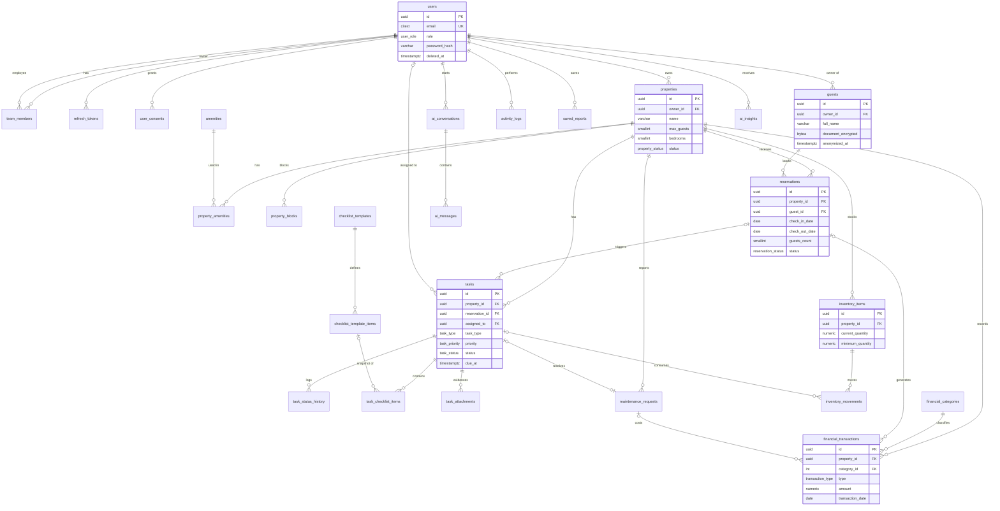

# Etapa 1 — Modelagem de Dados

> **Script de criação:** [`database/init/01_schema.sql`](../database/init/01_schema.sql)
> **Dados de referência:** [`database/init/02_seed.sql`](../database/init/02_seed.sql)
> **SGBD alvo:** PostgreSQL 15+ (validado em PostgreSQL 18)

## 1. Bounded Contexts (DDD) → Tabelas

O modelo foi desenhado já pensando nos *bounded contexts* que serão implementados no backend (Etapa 2). Cada contexto é dono das suas tabelas; as referências entre contextos são feitas apenas por ID.

| Contexto | Agregado raiz | Tabelas | Requisitos |
|---|---|---|---|
| **Identity & Access** | `User` | `users`, `team_members`, `refresh_tokens`, `user_consents` | RF-01, RF-02, RNF-01/02 |
| **Properties** | `Property` | `properties`, `amenities`, `property_amenities` | RF-03, RF-04 |
| **Bookings** | `Reservation` | `guests`, `reservations`, `property_blocks` | RF-05, RF-06, RF-07 |
| **Operations** | `Task`, `MaintenanceRequest`, `ChecklistTemplate` | `tasks`, `task_status_history`, `task_attachments`, `task_checklist_items`, `checklist_templates`, `checklist_template_items`, `maintenance_requests` | RF-08 a RF-11, RF-17 |
| **Inventory** | `InventoryItem` | `inventory_items`, `inventory_movements` | RF-12 |
| **Finance** | `FinancialTransaction` | `financial_categories`, `financial_transactions` | RF-13 |
| **Insights & AI** | `Conversation`, `Insight` | `activity_logs`, `saved_reports`, `ai_conversations`, `ai_messages`, `ai_insights` + 5 views | RF-14, RF-15, RF-16, RF-18 |

## 2. Diagrama Entidade-Relacionamento



## 3. Mapa de Chaves Estrangeiras (núcleo solicitado)

| Origem | Destino | `ON DELETE` | Justificativa |
|---|---|---|---|
| `properties.owner_id` | `users.id` | RESTRICT | Usuários usam *soft delete*; nunca perder o dono de um imóvel |
| `reservations.property_id` | `properties.id` | RESTRICT | Reservas são histórico financeiro/fiscal |
| `reservations.guest_id` | `guests.id` | RESTRICT | Hóspede é anonimizado (LGPD), não apagado |
| `tasks.property_id` | `properties.id` | RESTRICT | Preserva histórico operacional |
| `tasks.reservation_id` | `reservations.id` | SET NULL | Tarefa sobrevive sem a reserva |
| `tasks.assigned_to` | `users.id` | SET NULL | Tarefa volta para "não atribuída" |
| `financial_transactions.property_id` | `properties.id` | RESTRICT | Integridade contábil |
| `financial_transactions.(category_id, type)` | `financial_categories.(id, type)` | RESTRICT | **FK composta**: impede receita em categoria de despesa |
| `financial_transactions.reservation_id` | `reservations.id` | SET NULL | Lançamento é independente |
| `inventory_movements.item_id` | `inventory_items.id` | RESTRICT | Livro-razão de estoque |
| `property_amenities.property_id` | `properties.id` | CASCADE | Composição pura |
| `task_checklist_items.task_id` | `tasks.id` | CASCADE | Composição pura |

## 4. Regras de Negócio Garantidas pelo Banco

A validação primária acontece na **camada de domínio** (entidades e *value objects* do backend). O banco atua como **defesa em profundidade**:

| Regra | Mecanismo |
|---|---|
| Sem reservas sobrepostas no mesmo imóvel | `EXCLUDE USING gist` com `daterange '[)'` (ignora canceladas / no-show). Checkout e check-in no mesmo dia são permitidos |
| Hóspedes ≤ capacidade do imóvel | Trigger `fn_reservation_before_write` |
| Hóspede pertence ao mesmo proprietário do imóvel (isolamento de tenant) | Trigger `fn_reservation_before_write` |
| Tarefa não pode ser concluída com item obrigatório de checklist pendente (RF-11) | Trigger `fn_task_before_write` |
| Histórico automático de status das tarefas (RF-17) | Trigger `fn_task_log_status` + `app.current_user_id` |
| Saldo de estoque nunca negativo, com lock contra concorrência (RF-12) | Trigger `fn_inventory_apply_movement` (`SELECT … FOR UPDATE`) |
| Perfis corretos nas associações (ex.: funcionário não pode ser dono de imóvel) | Trigger genérico `fn_assert_user_role(coluna, perfis…)` |
| Trilhas de auditoria imutáveis | Trigger `fn_prevent_mutation` em `inventory_movements`, `task_status_history`, `activity_logs` |
| Consistência de estados (`completed ⇔ completed_at`, `cancelled ⇔ cancelled_at`, `paid ⇔ paid_date`) | `CHECK` constraints + carimbo automático por trigger |

## 5. LGPD e Segurança (RNF-01, RNF-02)

- **Minimização:** dados pessoais de hóspedes concentrados em `guests`; `activity_logs.changes` não deve conter PII.
- **Criptografia de documentos:** CPF/passaporte armazenado em `document_encrypted` (AES-256-GCM na aplicação, chave fora do banco) + `document_hash` (HMAC) para busca sem descriptografar.
- **Direito de eliminação:** `fn_anonymize_guest()` e `fn_anonymize_user()` anonimizam o titular preservando reservas e lançamentos (obrigação legal/fiscal — art. 16).
- **Prova de consentimento:** `user_consents` com versão da política, data e IP.
- **Autenticação:** apenas hash de senha (Argon2id); refresh tokens armazenados como SHA-256, com rotação e detecção de reuso (`family_id`); bloqueio por tentativas (`failed_login_attempts`, `locked_until`).
- **IDs não enumeráveis:** UUID v4 em todas as entidades expostas por API.

## 6. Desempenho e Escalabilidade (RNF-05, RNF-07, RNF-09)

- Índices desenhados a partir das consultas reais: "minhas tarefas" (`assigned_to, status, due_at`), calendário (`property_id, check_in_date` + índice GiST), fluxo de caixa (`transaction_date, type`).
- **Índices parciais** para os conjuntos "quentes" (tarefas abertas, estoque baixo, lançamentos pendentes), que permanecem pequenos mesmo com milhões de linhas históricas.
- Índice **BRIN** em `activity_logs.occurred_at` (tabela append-only de crescimento contínuo). Evolução natural: particionamento mensal por `occurred_at` sem alterar a aplicação.
- **Views analíticas** (`vw_property_monthly_occupancy`, `vw_monthly_cash_flow`, `vw_low_stock_items`, `vw_overdue_tasks`) alimentam o dashboard e servirão como fontes de dados seguras e agregadas para o Assistente de IA (Etapa 4). Podem ser convertidas em *materialized views* quando o volume exigir.

## 7. Como Executar

```bash
# Com Docker (recomendado) — os scripts de database/init rodam automaticamente
docker compose up -d db

# Ou manualmente em um PostgreSQL existente
psql -U postgres -d locacao -f database/init/01_schema.sql
psql -U postgres -d locacao -f database/init/02_seed.sql
```

> Na Etapa 2, este script passa a ser a *baseline* das migrações Alembic do backend.
